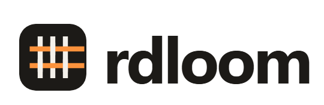
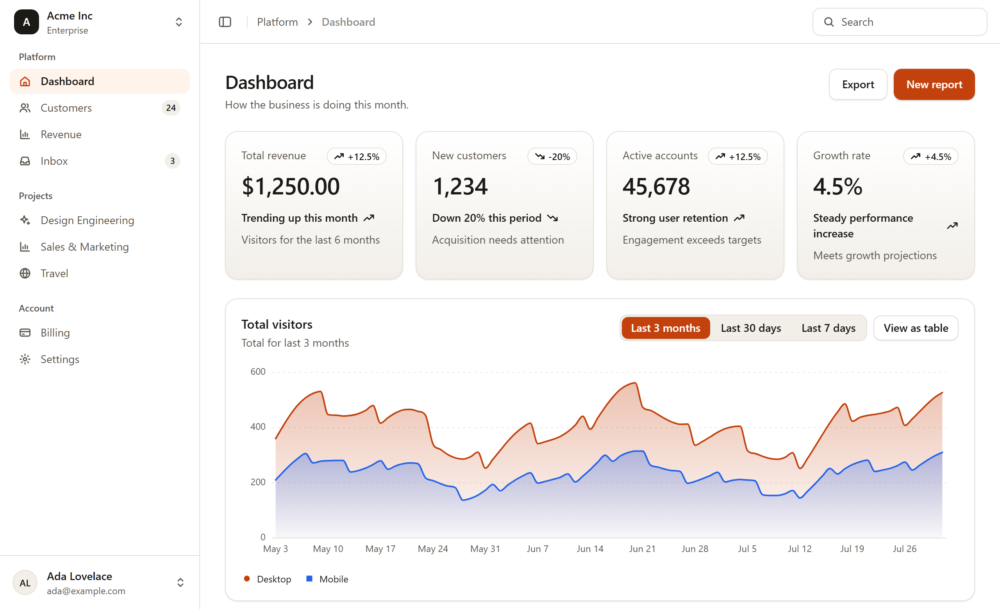
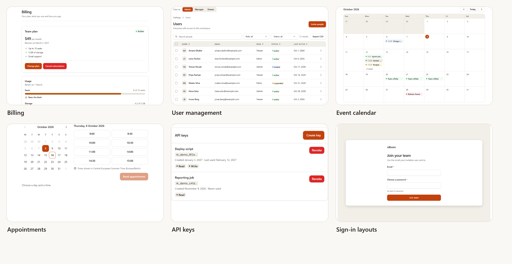
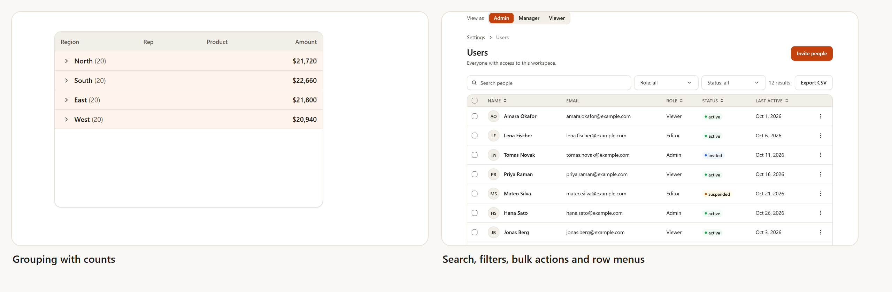
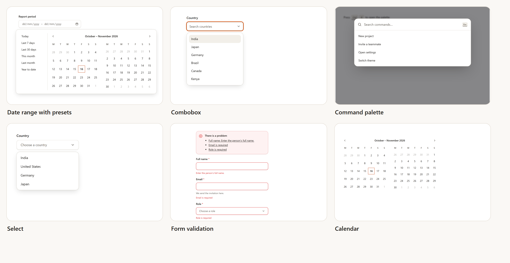
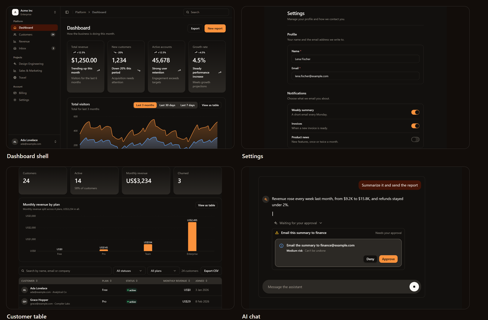
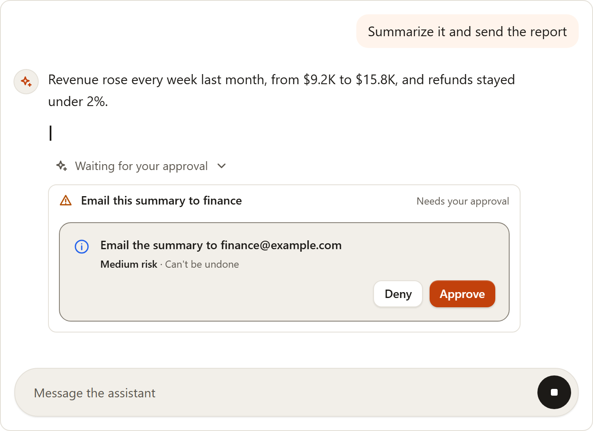
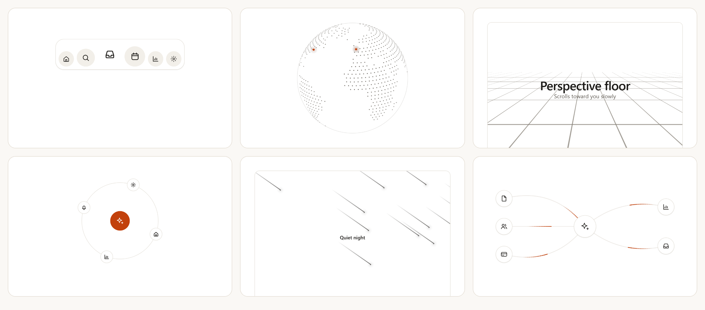
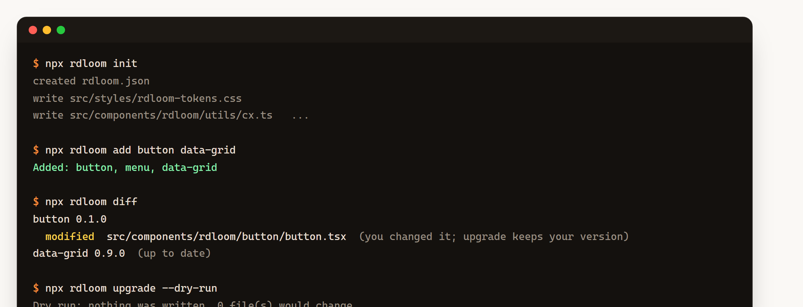
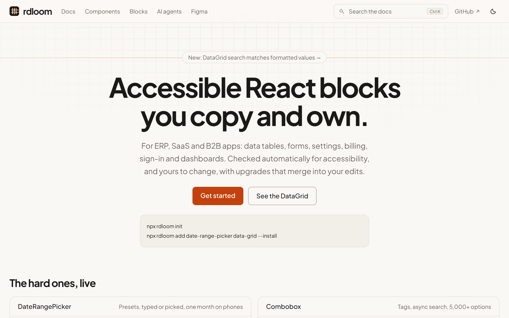

<div align="center">

<a href="https://rdloom.vimalbhatt.com">
  <picture>
    <source media="(prefers-color-scheme: dark)" srcset="docs/assets/brand/logo-dark.png" />
    
  </picture>
</a>

<h3>Accessible React blocks you copy into your app and own.</h3>

<p>Data tables, forms, dashboards, settings, billing, sign-in, an AI chat and 69 motion effects,<br />built for ERP, SaaS and B2B products.</p>

[](https://github.com/DevHydeOut/rdloom/actions/workflows/ci.yml)
[](https://www.npmjs.com/package/rdloom)
[](https://www.npmjs.com/package/@rdloom/mcp)
[](LICENSE)
[](#project-status)
[](https://react-spectrum.adobe.com/react-aria/)

**[Get started](https://rdloom.vimalbhatt.com/docs/getting-started)** &nbsp;·&nbsp;
**[Components](https://rdloom.vimalbhatt.com/components)** &nbsp;·&nbsp;
**[Blocks](https://rdloom.vimalbhatt.com/blocks)** &nbsp;·&nbsp;
**[AI agents](https://rdloom.vimalbhatt.com/docs/mcp)** &nbsp;·&nbsp;
**[Changelog](CHANGELOG.md)**

</div>

<br />

<picture>
  <source media="(prefers-color-scheme: dark)" srcset="docs/assets/readme/shell-dark.png" />
  
</picture>

<br />
<br />

<div align="center">

| **179** | **21** | **69** | **15** | **2** |
|:---:|:---:|:---:|:---:|:---:|
| components and blocks | ready-made blocks | motion effects | AI components | themes, light and dark |

</div>

rdloom is a library of React blocks and components for **ERP, SaaS and B2B apps**. You add what you need with one command. The source lands in **your** project, so you can read it, change it and keep it, and later take new versions without losing your edits.

## Why rdloom

<table>
  <tr>
    <td width="33%" valign="top"><b>You own the code</b><br />Components are copied into your project, not imported from a package you cannot change. Nothing breaks when we publish a new version.</td>
    <td width="33%" valign="top"><b>Upgrades that merge</b><br /><code>rdloom upgrade</code> compares the shipped, your and the new version, and merges them the way git does. Real conflicts get conflict markers.</td>
    <td width="33%" valign="top"><b>Accessible by default</b><br />Built on React Aria Components. Keyboard, focus and screen reader support are part of every component, and every example is checked with automated accessibility tests.</td>
  </tr>
  <tr>
    <td valign="top"><b>Made for business apps</b><br />Tables with a lot of rows, validated forms, permissions, and loading, empty and error states for the screens of an admin or SaaS product.</td>
    <td valign="top"><b>Your API stays yours</b><br />rdloom owns the screen around a request. It never fetches data, signs anyone in or does routing, so it works with any backend.</td>
    <td valign="top"><b>Your look</b><br />Your app's font and rdloom's design tokens, in light and dark. Change a token and the whole product follows.</td>
  </tr>
</table>

## A tour

### Blocks for real products

Whole screens, not just parts: billing, user management, calendars, appointments, API keys and sign-in layouts. Each block takes your data and your callbacks, and handles the loading, empty, error and permission states.



### Data at scale

The **DataGrid** handles tens of thousands of rows with sorting, filtering, grouping, in-place editing, range copy and paste, CSV export, pinned columns, row reorder and server-side data. A search box that matches the values people actually see, and tables with bulk actions and row menus.



### Inputs and forms that behave

Date range pickers with presets, comboboxes that load more as you scroll, a command palette, selects, calendars and a form that gathers its errors into one summary. All of it works with a keyboard and a screen reader.



### Light and dark, from one set of tokens

Every colour, space, radius and shadow is a design token. Light and dark follow the visitor's setting, or you force one with `data-theme`. The same tokens are exported for Figma, so design and code share one source.



### An AI chat that asks before it acts

Streaming replies, tool steps, approvals, citations and generated charts and tables. It never calls a model: you bring your own, and the chat shows exactly what you give it, including a clear Approve or Deny step before anything that changes the outside world.



### Motion for landing pages and product moments

69 optional effects: text effects, backgrounds, a dock, a globe, a terminal, a marquee, a bento grid, an animated beam and more. Every one stands still for visitors who prefer reduced motion, can be paused, and is hidden from assistive technology when it is only decoration.



### Own the code, and still take upgrades

One command copies a component into your project. Edit it freely. When a new version ships, `rdloom upgrade` shows what would change and merges it into your edits, the way git does.



### Made for AI coding tools

The **`@rdloom/mcp`** server gives Claude Code, Cursor and other MCP clients the real props, usage rules, accessibility requirements, tokens and tested examples, so they write correct code the first time instead of guessing. It is read-only and needs no network access.

```bash
claude mcp add rdloom -- npx rdloom-mcp
```

```json
{
  "mcpServers": {
    "rdloom": { "command": "npx", "args": ["rdloom-mcp"] }
  }
}
```

Tools: `list_components`, `get_component`, `get_example`, `get_component_source`, `get_tokens`, `validate_props` and `get_setup`.

## Quick start

You need React 18.3 or 19, Tailwind CSS 3.4 or 4, and Node 22 or newer for the CLI.

**1. Set up your project**

```bash
npx rdloom init
```

This writes `rdloom.json`, copies the design tokens and adds a few shared helpers.

**2. Import the tokens and point Tailwind at the components** (Tailwind 4 shown)

```css
/* src/index.css */
@import "tailwindcss";
@import "./styles/rdloom-tokens.css";
@source "./components/rdloom";
```

**3. Add what you need**

```bash
npx rdloom add button date-range-picker data-grid --install
```

The source is copied to `src/components/rdloom/`, and `--install` adds the npm packages it uses. Then import it like any file of your own:

```tsx
import { Button } from "./components/rdloom/button/button";
import { DataGrid } from "./components/rdloom/data-grid/data-grid";

export function Orders({ orders }) {
  return (
    <>
      <Button onPress={() => save()}>Save</Button>
      <DataGrid label="Orders" data={orders} columns={columns} getRowId={(o) => o.id} height={480} />
    </>
  );
}
```

**4. Commit the lock file.** Commit `rdloom.json`, `rdloom.lock.json` and the `.rdloom/` folder. They let `npx rdloom upgrade` merge new versions into your edits.

```bash
npx rdloom list                 # everything you can add
npx rdloom diff                 # your changes against upstream, per file
npx rdloom upgrade --dry-run    # what an upgrade would do, writing nothing
npx rdloom upgrade              # apply it
```

> The full guide, with every component, its examples and its accessibility notes, is on the **[documentation site](https://rdloom.vimalbhatt.com/docs/getting-started)**.

## What is inside

**179 items** in total. Everything is optional: you only get what you add.

| Category | Items | Examples |
|---|---:|---|
| **Inputs** | 26 | Text field, select, combobox, date and date-range pickers, time slot picker, number field, slider, file upload, color picker, rating, one-time code |
| **Data** | 7 | **DataGrid** (sorting, filtering, grouping, editing, copy and paste, export, server-side data), table, tree, file tree, chart, stat, sparkline |
| **Blocks** | 21 | Dashboard shell and page, sidebar, customer table, data table, user form, invite dialog, settings section, plan card, usage meter, payment method card, API key list, auth card, event calendar |
| **Overlays and feedback** | 17 | Dialog, alert dialog, drawer, sheet, popover, command palette, tooltip, toast, alert, progress, skeleton, empty and error states |
| **Navigation and layout** | 11 | Tabs, breadcrumbs, pagination, steps, menubar, navigation menu, accordion, card, resizable panels |
| **Display and actions** | 13 | Button, menu, action button with permissions, avatar, badge, carousel, scroll area, typography |
| **AI** | 15 | Chat, messages, tool calls, approvals, citations, sources, prompt input, generated charts and tables |
| **Motion and effects** | 69 | Text effects, backgrounds and patterns, dock, globe, terminal, marquee, bento grid, animated beam and more |

## Documentation

Every component and block has its own page on the **[documentation site](https://rdloom.vimalbhatt.com)**: live examples you can use, copy-ready code, the full props table, keyboard and screen reader behaviour, and guidelines for when to use it and when not to. There is a guide for the CLI and upgrades, one for AI agents, one for the Figma plugin and one for the design tokens.



## Accessibility

- Built on React Aria Components: keyboard navigation, focus management and screen reader semantics come from a well-tested foundation.
- Every example is checked with automated accessibility tests (axe), and each component page lists its keyboard and screen reader behaviour.
- The target is WCAG 2.2 AA.
- **Not done yet:** a full manual pass with NVDA and VoiceOver. Until then, treat the screen reader notes as intent, and please report anything that does not work. The current state is in [docs/accessibility-audit.md](docs/accessibility-audit.md).

## Works with

| Setup | Versions |
|---|---|
| React | 18.3 and 19 |
| Tailwind CSS | 3.4 and 4 |
| Vite | 6 and 7 |
| Next.js | 15, App Router (every component has `"use client"`) |
| React Router | 7, server rendering |
| Astro | 5, as React islands |
| Package managers | npm, pnpm, yarn, bun |

Next.js and Vite are rebuilt on every change in our own CI. The others were checked by hand for a release. The [Getting started](https://rdloom.vimalbhatt.com/docs/getting-started#works-with) page has the details.

## Project status

rdloom is **below version 1.0**, so every component is marked **experimental**: a prop or a name can still change in a minor release, and each change is listed in the [changelog](CHANGELOG.md). Because you copy the source and upgrades merge into your edits, a change never breaks your app unless you choose to upgrade. A component becomes stable once it has been used in real projects and has had a manual screen reader pass.

## How it works

Every component starts as one small JSON file in `specs/`. From it we generate the TypeScript types, the install files, the documentation pages, the context for AI tools and the Figma data, so the docs, the code and the tools always agree.

```
specs/*.spec.json  +  tokens
        |
        v
     codegen  ->  types · registry · docs data · MCP context · Figma data
```

| Folder | What it holds |
|---|---|
| `specs/` | One JSON spec per component: props, states, accessibility rules |
| `packages/react/` | The components that get copied into your app |
| `packages/cli/` | The `rdloom` command |
| `packages/mcp/` | The MCP server for AI coding tools |
| `packages/figma/` | The Figma plugin |
| `apps/docs/` | The documentation website |
| `examples/` | Tested examples shown in the docs |

## Contributing

Bug reports, ideas and pull requests are welcome.

```bash
git clone https://github.com/DevHydeOut/rdloom.git
cd rdloom
npm ci
npm run build      # generate, typecheck and run all unit tests
npm run docs       # open the documentation site locally
```

Read [CONTRIBUTING.md](CONTRIBUTING.md) before you open a pull request: it covers the branches we use, how to write commit messages and what we check. The [developer guide](docs/developer-guide.md) explains the repository in detail.

> **Found a bug or a security issue?**
> Bugs and problems: [open an issue](https://github.com/DevHydeOut/rdloom/issues/new/choose).
> Security issues: please do not post them in public. Use [private reporting](https://github.com/DevHydeOut/rdloom/security/advisories/new). More in [SECURITY.md](SECURITY.md).

## License

[MIT](LICENSE). Built by the rdloom team.
