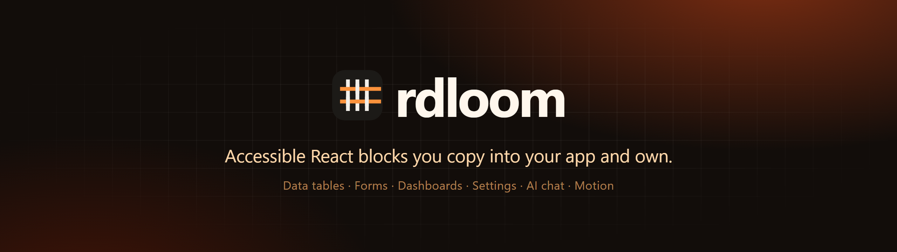
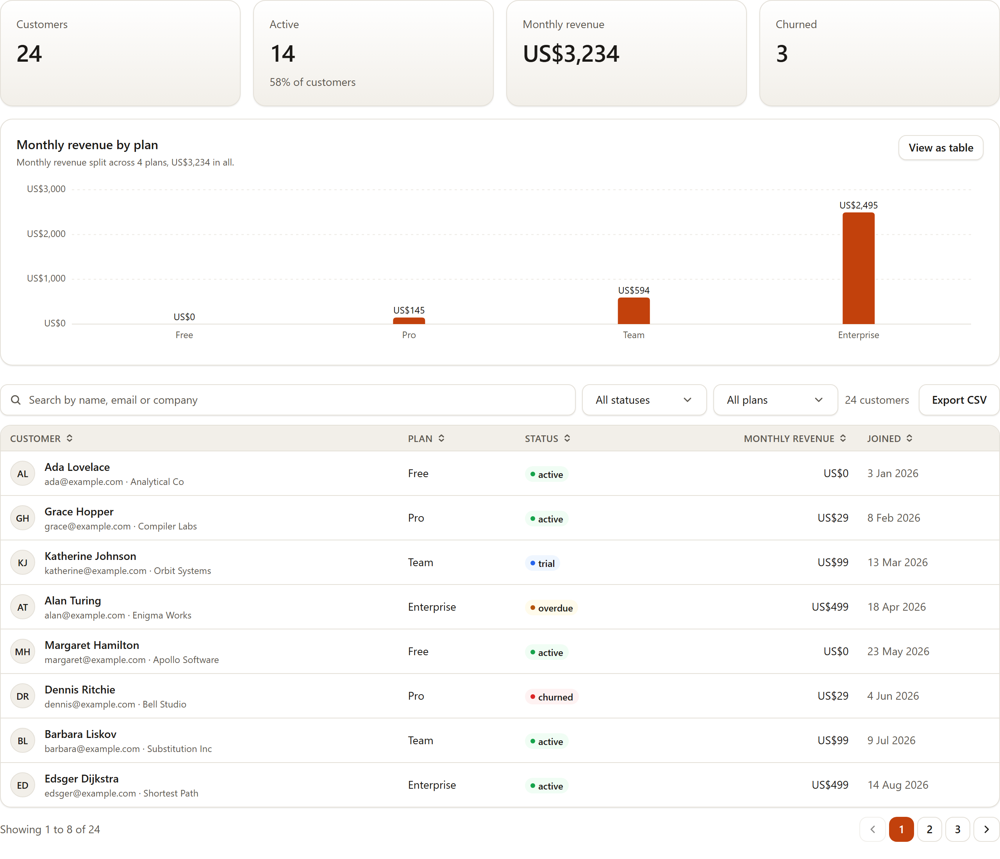
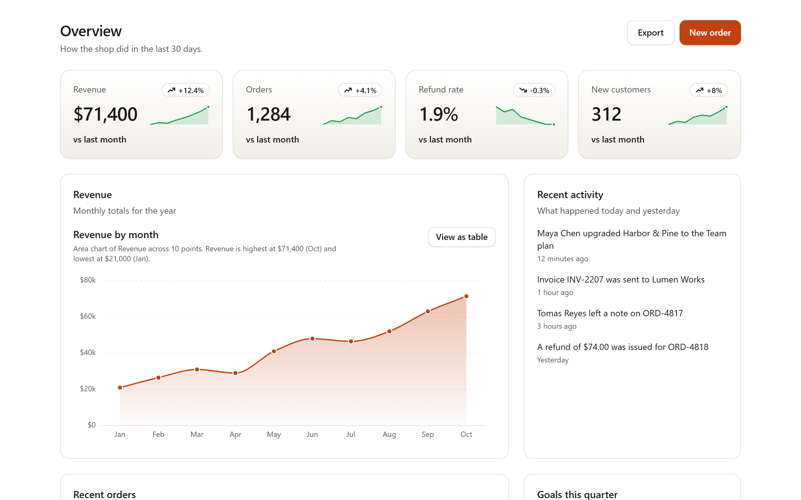
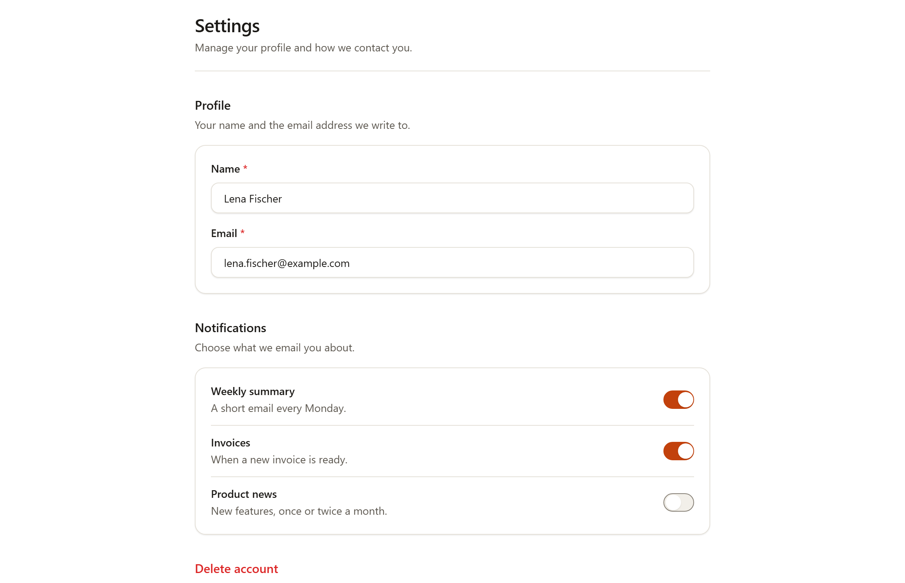
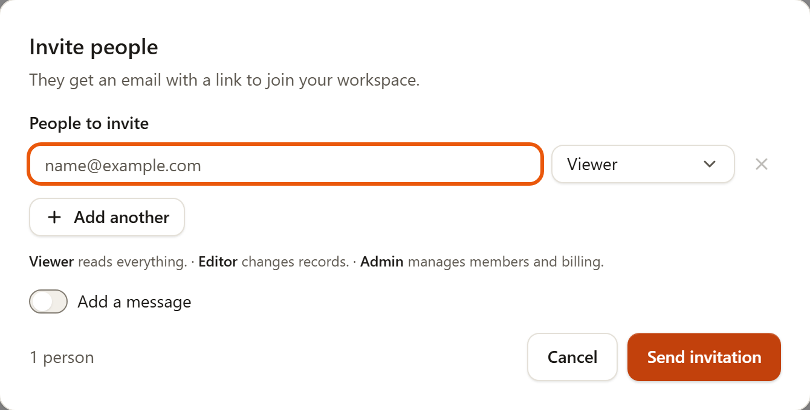
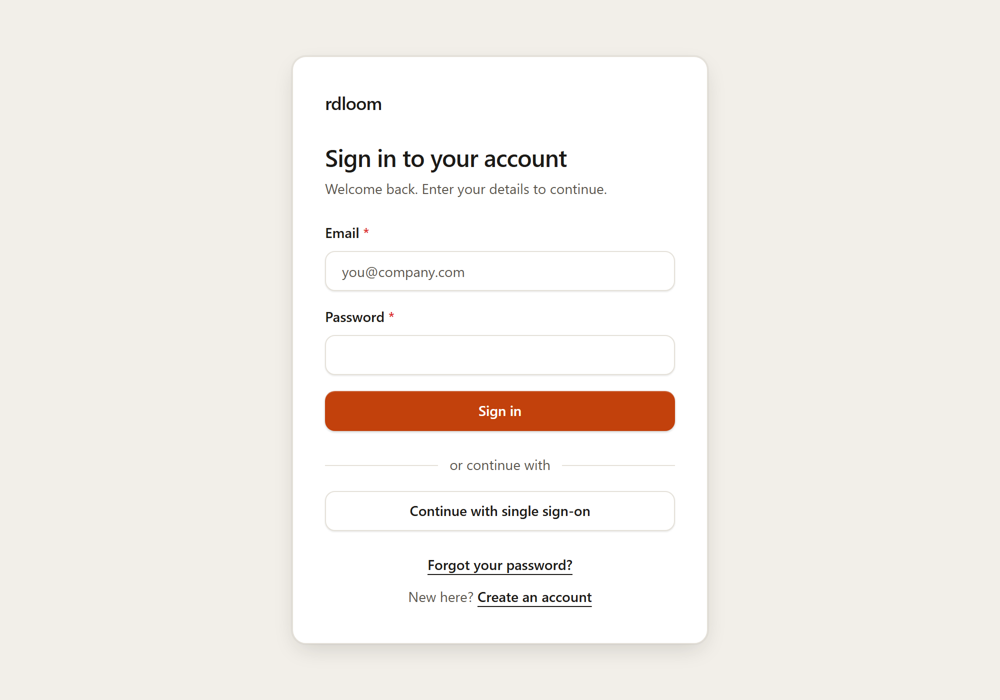

<div align="center">



<br />
<br />

[](https://github.com/DevHydeOut/rdloom/actions/workflows/ci.yml)
[](https://www.npmjs.com/package/rdloom)
[](https://www.npmjs.com/package/@rdloom/mcp)
[](LICENSE)
[](#project-status)
[](https://react-spectrum.adobe.com/react-aria/)

**[Documentation](https://rdloom.vimalbhatt.com)** &nbsp;·&nbsp;
**[Components](https://rdloom.vimalbhatt.com/components)** &nbsp;·&nbsp;
**[Blocks](https://rdloom.vimalbhatt.com/blocks)** &nbsp;·&nbsp;
**[AI agents](https://rdloom.vimalbhatt.com/docs/mcp)** &nbsp;·&nbsp;
**[Changelog](CHANGELOG.md)**

</div>

<br />

rdloom is a library of React blocks and components for **ERP, SaaS and B2B apps**: data tables, forms, dashboards, settings and billing pages, sign-in screens, invite dialogs, an AI chat and more. You add what you need with one command. The source lands in **your** project, so you can read it, change it and keep it, and later take new versions without losing your edits.

<picture>
  <source media="(prefers-color-scheme: dark)" srcset="docs/assets/readme/shell-dark.png" />
  
</picture>

<sub>The dashboard shell, stat cards and chart blocks. Light and dark mode come from the same design tokens.</sub>

## Why rdloom

| Principle | In practice |
|---|---|
| **You own the code** | Components are copied into your project, not imported from a package you cannot change. Nothing breaks when we publish a new version. |
| **Upgrades that merge** | `rdloom upgrade` compares three versions, as shipped, yours and the new one, and merges them the way git does. Real conflicts get conflict markers. |
| **Accessible by default** | Built on [React Aria Components](https://react-spectrum.adobe.com/react-aria/). Keyboard use, focus and screen reader support are part of every component, and every example is checked with automated accessibility tests. |
| **Made for business apps** | Tables with a lot of rows, forms with validation, permissions, loading, empty and error states, and the layouts of an admin or SaaS product. |
| **Your API stays yours** | rdloom owns the screen around a request. It never fetches data, signs anyone in or does routing for you, so it works with any backend. |
| **Your look** | Uses your app's font and its own design tokens, in light and dark. Change a token, change the whole product. |

## See it

<table>
  <tr>
    <td width="50%"><br /><sub><b>Customer table.</b> Insights, search, filters, sorting, paging and export, with permissions per action.</sub></td>
    <td width="50%"><br /><sub><b>AI chat.</b> Streaming replies, tool steps and approvals. It never calls a model: you bring your own.</sub></td>
  </tr>
  <tr>
    <td width="50%"><br /><sub><b>Dashboard page.</b> Stat cards with sparklines, charts with a table view, activity and goals.</sub></td>
    <td width="50%"><br /><sub><b>Settings.</b> Sections, validated fields, toggles and a danger zone.</sub></td>
  </tr>
  <tr>
    <td width="50%"><br /><sub><b>Invite people.</b> Typed emails, a directory search or a pick from a list, with roles and server errors.</sub></td>
    <td width="50%"><br /><sub><b>Sign-in screens.</b> Sign in, sign up, forgot password and one-time code, in several layouts.</sub></td>
  </tr>
</table>

## Quick start

You need React 18.3 or 19, Tailwind CSS 3.4 or 4, and Node 22 or newer for the CLI.

**1. Set up your project**

```bash
npx rdloom init
```

This writes `rdloom.json`, copies the design tokens and adds a few shared helpers.

**2. Import the tokens and point Tailwind at the components** (Tailwind 4 shown)

```css
/* src/index.css */
@import "tailwindcss";
@import "./styles/rdloom-tokens.css";
@source "./components/rdloom";
```

**3. Add what you need**

```bash
npx rdloom add button date-range-picker data-grid --install
```

The source is copied to `src/components/rdloom/`, and `--install` adds the npm packages it uses. Then import it like any file of your own:

```tsx
import { Button } from "./components/rdloom/button/button";
import { DataGrid } from "./components/rdloom/data-grid/data-grid";

export function Orders({ orders }) {
  return (
    <>
      <Button onPress={() => save()}>Save</Button>
      <DataGrid label="Orders" data={orders} columns={columns} getRowId={(o) => o.id} height={480} />
    </>
  );
}
```

**4. Commit the lock file.** Commit `rdloom.json`, `rdloom.lock.json` and the `.rdloom/` folder. They let `npx rdloom upgrade` merge new versions into your edits.

```bash
npx rdloom list                 # everything you can add
npx rdloom diff                 # your changes against upstream, per file
npx rdloom upgrade --dry-run    # what an upgrade would do, writing nothing
npx rdloom upgrade              # apply it
```

> The full guide, with every component, its examples and its accessibility notes, is on the **[documentation site](https://rdloom.vimalbhatt.com/docs/getting-started)**.

## What is inside

**179 items** in total. Everything is optional: you only get what you add.

| Category | Items | Examples |
|---|---:|---|
| **Inputs** | 26 | Text field, select, combobox, date and date-range pickers, time slot picker, number field, slider, file upload, color picker, rating, one-time code |
| **Data** | 7 | **DataGrid** (sorting, filtering, grouping, editing, copy and paste, export, server-side data), table, tree, file tree, chart, stat, sparkline |
| **Blocks** | 21 | Dashboard shell and page, sidebar, customer table, data table, user form, invite dialog, settings section, plan card, usage meter, payment method card, API key list, auth card, event calendar |
| **Overlays and feedback** | 17 | Dialog, alert dialog, drawer, sheet, popover, command palette, tooltip, toast, alert, progress, skeleton, empty and error states |
| **Navigation and layout** | 11 | Tabs, breadcrumbs, pagination, steps, menubar, navigation menu, accordion, card, resizable panels |
| **Display and actions** | 13 | Button, menu, action button with permissions, avatar, badge, carousel, scroll area, typography |
| **AI** | 15 | Chat, messages, tool calls, approvals, citations, sources, prompt input, generated charts and tables |
| **Motion and effects** | 69 | Text effects, backgrounds and patterns, dock, globe, terminal, marquee, bento grid, animated beam and more |

### Motion and effects

An optional set for landing pages and product moments. Every one stands still for visitors who prefer reduced motion, can be paused, and is hidden from assistive technology when it is only decoration.


## Made for AI coding tools

The **`@rdloom/mcp`** server gives Claude Code, Cursor and other MCP clients the real props, usage rules, accessibility requirements, design tokens and tested examples, so they write correct code the first time instead of guessing. It is read-only and needs no network access.

```bash
claude mcp add rdloom -- npx rdloom-mcp
```

or in an MCP config such as `.mcp.json`:

```json
{
  "mcpServers": {
    "rdloom": { "command": "npx", "args": ["rdloom-mcp"] }
  }
}
```

Tools: `list_components`, `get_component`, `get_example`, `get_component_source`, `get_tokens`, `validate_props` and `get_setup`.

## Design tokens and theming

All colour, spacing, radius, type and elevation values are tokens (CSS variables such as `--rd-color-action-primary`). Light and dark follow `prefers-color-scheme`. To force a theme, set `data-theme="light"` or `data-theme="dark"` on `<html>`. The same tokens are exported for Figma, so design and code share one source.

## Accessibility

- Built on React Aria Components: keyboard navigation, focus management and screen reader semantics come from a well-tested foundation.
- Every example is checked with automated accessibility tests (axe), and each component page lists its keyboard and screen reader behaviour.
- The target is WCAG 2.2 AA.
- **Not done yet:** a full manual pass with NVDA and VoiceOver. Until then, treat the screen reader notes as intent, and please report anything that does not work. The current state is in [docs/accessibility-audit.md](docs/accessibility-audit.md).

## Works with

| Setup | Versions |
|---|---|
| React | 18.3 and 19 |
| Tailwind CSS | 3.4 and 4 |
| Vite | 6 and 7 |
| Next.js | 15, App Router (every component has `"use client"`) |
| React Router | 7, server rendering |
| Astro | 5, as React islands |
| Package managers | npm, pnpm, yarn, bun |

Next.js and Vite are rebuilt on every change in our own CI. The others were checked by hand for a release. The [Getting started](https://rdloom.vimalbhatt.com/docs/getting-started#works-with) page has the details.

## Project status

rdloom is **below version 1.0**, so every component is marked **experimental**: a prop or a name can still change in a minor release, and each change is listed in the [changelog](CHANGELOG.md). Because you copy the source and upgrades merge into your edits, a change never breaks your app unless you choose to upgrade. A component becomes stable once it has been used in real projects and has had a manual screen reader pass.

## How it works

Every component starts as one small JSON file in `specs/`. From it we generate the TypeScript types, the install files, the documentation pages, the context for AI tools and the Figma data, so the docs, the code and the tools always agree.

```
specs/*.spec.json  +  tokens
        |
        v
     codegen  ->  types · registry · docs data · MCP context · Figma data
```

| Folder | What it holds |
|---|---|
| `specs/` | One JSON spec per component: props, states, accessibility rules |
| `packages/react/` | The components that get copied into your app |
| `packages/cli/` | The `rdloom` command |
| `packages/mcp/` | The MCP server for AI coding tools |
| `packages/figma/` | The Figma plugin |
| `apps/docs/` | The documentation website |
| `examples/` | Tested examples shown in the docs |

## Contributing

Bug reports, ideas and pull requests are welcome.

```bash
git clone https://github.com/DevHydeOut/rdloom.git
cd rdloom
npm ci
npm run build      # generate, typecheck and run all unit tests
npm run docs       # open the documentation site locally
```

Read [CONTRIBUTING.md](CONTRIBUTING.md) before you open a pull request: it covers the branches we use, how to write commit messages and what we check. The [developer guide](docs/developer-guide.md) explains the repository in detail.

> **Found a bug or a security issue?**
> Bugs and problems: [open an issue](https://github.com/DevHydeOut/rdloom/issues/new/choose).
> Security issues: please do not post them in public. Use [private reporting](https://github.com/DevHydeOut/rdloom/security/advisories/new). More in [SECURITY.md](SECURITY.md).

## License

[MIT](LICENSE). Built by the rdloom team.
